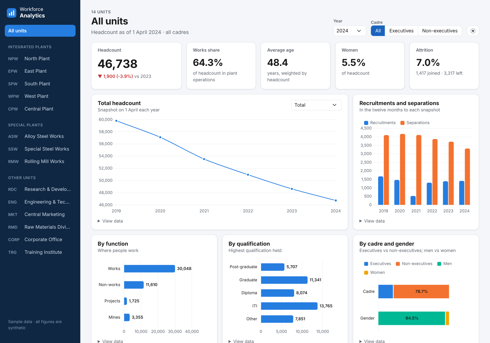
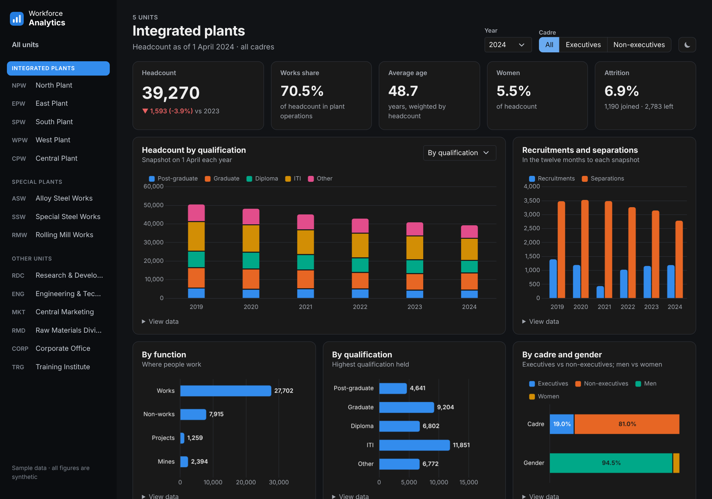

# Workforce Analytics Dashboard


An HR headcount dashboard for a multi-site organisation: pick a plant, a group of units or the whole
organisation, choose a year and cadre, and see headcount, where people work, qualifications, gender mix,
age, hiring and attrition, plus how each of those has changed over time.

Built with **ASP.NET Core 10 (MVC)**, **Chart.js** and **Oracle**, with a bundled synthetic dataset so it runs
anywhere with no database.



<details>
<summary>Dark theme</summary>


</details>

> **All numbers in this repository are synthetic.** The sample dataset is generated by
> [`tools/generate_sample_data.py`](tools/generate_sample_data.py); unit names are invented.

## Contents

- [Features](#features)
- [Getting started](#getting-started)
- [Data](#data)
- [Connecting to Oracle](#connecting-to-oracle)
- [Architecture](#architecture)
- [API](#api)
- [Tests and CI](#tests-and-ci)
- [Security and operations](#security-and-operations)
- [Design notes](#design-notes)
- [Limitations and next steps](#limitations-and-next-steps)

## Features

- **Five headline figures** for any selection: headcount (with change from the previous year), works share,
  average age (weighted by headcount), share of women, and attrition rate.
- **Trends** over every year in the data, broken down by cadre, function, gender or qualification.
- **Recruitments vs separations** per year, so the reason headcount moved is visible next to the headcount itself.
- **Breakdowns** for the selected year: function (works / non-works / projects / mines), qualification,
  cadre and gender, and a **unit-by-unit comparison** when a group or the whole organisation is selected.
- **Filters**: unit, unit group, year, and cadre (all / executives / non-executives). Every view has its own URL,
  so it can be bookmarked or shared, and the browser's back button works.
- **Readable everywhere**: light and dark themes (follows the OS, with a toggle), works on a phone, and every chart
  has a "View data" table for exact numbers and screen readers. The chart palette was checked for colour-blind
  separation in both themes.
- **Works without JavaScript**: the first view is rendered on the server and the filters fall back to a normal form.

## Getting started

Requires the [.NET 10 SDK](https://dotnet.microsoft.com/download).

```bash
git clone https://github.com/<you>/workforce-dashboard.git
cd workforce-dashboard
dotnet run --project src/WorkforceDashboard
```

Open the URL it prints (http://localhost:5210 by default). It starts on the bundled sample data; no database is needed.

In Visual Studio 2026 or Rider, open `WorkforceDashboard.slnx` and run the `WorkforceDashboard` project.

## Data

Each row is the headcount of one **cadre** (executive or non-executive) in one **unit** on a **snapshot date**
(1 April each year):

| Column group | Columns |
|---|---|
| Identity | unit, snapshot date, cadre |
| Headcount | manpower |
| Function | works, non-works, projects, mines (sum to manpower) |
| Movement | recruitments, separations (in the twelve months to the snapshot) |
| People | average age, male, female (sum to manpower) |
| Qualification | post-graduate, graduate, diploma, ITI, higher secondary, matriculate, below matriculate (sum to manpower) |

The sample dataset covers **14 units in three groups, 2019–2024** (168 rows). It lives in
[`src/WorkforceDashboard/Data/sample/`](src/WorkforceDashboard/Data/sample) and is internally consistent: the
breakdowns always add up, and each year's headcount equals the previous year's plus recruitments minus separations
(the tests check both). To regenerate it, or make a different one:

```bash
python tools/generate_sample_data.py --seed 42 --first-year 2019 --last-year 2024
```

This rewrites the CSV files and [`db/oracle/sample_data.sql`](db/oracle/sample_data.sql) from the same numbers.

**How the figures are calculated**

- *Average age* is weighted by headcount. Averaging the per-unit averages would give a small office the same
  weight as a large plant.
- *Attrition* is separations divided by the average of opening and closing headcount for the year.
- *Change* compares the selected year's snapshot with the previous year's, for the same selection.

## Connecting to Oracle

1. Create the tables with [`db/oracle/schema.sql`](db/oracle/schema.sql), and optionally load the sample data
   with [`db/oracle/sample_data.sql`](db/oracle/sample_data.sql).
2. Give the app an account that can only `SELECT` from `unit_mas` and `manpower_data` (the grant is at the end of the schema file).
3. Set the provider and connection string. Keep the connection string out of source control, for example with user secrets:

   ```bash
   cd src/WorkforceDashboard
   dotnet user-secrets init
   dotnet user-secrets set "ConnectionStrings:Workforce" "User Id=workforce_app;Password=...;Data Source=dbhost:1521/ORCLPDB1"
   dotnet user-secrets set "WorkforceData:Provider" "Oracle"
   ```

   or, on a server, with environment variables: `ConnectionStrings__Workforce` and `WorkforceData__Provider=Oracle`.

| Setting (`WorkforceData:…`) | Default | Meaning |
|---|---|---|
| `Provider` | `Sample` | `Sample` or `Oracle` |
| `ConnectionStringName` | `Workforce` | Which entry under `ConnectionStrings` to use |
| `CacheMinutes` | `10` | How long Oracle results are kept in memory (headcount is a yearly snapshot) |
| `FallBackToSample` | `true` | If Oracle can't be reached, show the sample data with a clear notice instead of an error page |
| `RetryAfterFailureSeconds` | `120` | After a failure, wait this long before trying Oracle again, so an outage doesn't make every page wait for a timeout |

The schema stores the snapshot date as a real `DATE` and uses check constraints to reject rows whose breakdowns
don't add up to the headcount, so bad loads fail at the database rather than showing wrong charts.

## Architecture

```
Browser ── GET /  ──────────────► DashboardController ──┐   (server-rendered first view)
        ── GET /api/dashboard ─► Dashboard API ─────────┤   (JSON for every filter change after that)
                                                        ▼
                                                DashboardService
                                                        │
                              WorkforceAnalytics (pure functions: filtering, KPIs, breakdowns, trends)
                                                        │
                                              IWorkforceRepository
                             ┌──────────────────────────┴───────────────────────────┐
                 CsvWorkforceRepository                         CachingFallbackRepository
                 (bundled sample data)                          ├─ OracleWorkforceRepository (ODP.NET, pooled)
                                                                └─ falls back to the sample data on failure
```

```
src/WorkforceDashboard/
  Controllers/      page controller (dashboard, error page)
  Data/             repositories, options, sample CSV files
  Infrastructure/   API endpoints, query validation, security headers, health check, rate-limit policy
  Models/           units, snapshots, query, response shapes
  Services/         WorkforceAnalytics (all the maths), DashboardService
  Views/            Razor views
  wwwroot/          CSS, dashboard.js, vendored Chart.js and Bootstrap CSS
tests/WorkforceDashboard.Tests/   xUnit: analytics, sample data, caching/fallback, query parsing, HTTP endpoints
db/oracle/        schema and sample data
tools/            synthetic data generator
```

The dataset is small (units × years × 2 cadres), so the repository loads it whole and the analytics run in memory.
That keeps every calculation in one tested place instead of spread across SQL strings. For a much larger history,
the same `IWorkforceRepository` could push the filtering down into SQL.

## API

`GET /api/dashboard?scope=…&year=…&cadre=…` returns everything the page shows for one selection.

| Parameter | Values | Default |
|---|---|---|
| `scope` | `all`, `group:<group name>` (e.g. `group:Integrated plants`) or a unit code (e.g. `EPW`) | `all` |
| `year` | any year in the data | latest year |
| `cadre` | `all`, `executive`, `non-executive` | `all` |

Invalid values return `400` with an RFC 9457 problem-details body explaining what was wrong.
`GET /api/units` lists unit groups and units. `GET /health` reports whether the data source is reachable
(`Healthy`, `Degraded` when serving the fallback sample, or `Unhealthy`).

## Tests and CI

```bash
dotnet test
```

42 tests cover the analytics (weighted age, attrition, shares, filters, scopes, trends adding up to totals),
the sample data's consistency, the caching/fallback behaviour (including the retry back-off, using a controllable
clock), query validation, and the HTTP endpoints end to end with `WebApplicationFactory` (page, API, error cases,
security headers, health check).

GitHub Actions builds and tests every push and pull request with warnings treated as errors, and checks that the
sample data still matches the generator. Dependabot keeps NuGet packages and Actions up to date.

## Security and operations

- **Strict Content Security Policy**: scripts, styles and fonts are all served from the app itself (Chart.js and
  Bootstrap are vendored), with no inline script. The initial data is embedded as `application/json`, which
  browsers don't execute.
- Security headers on every response (`X-Content-Type-Options`, `X-Frame-Options`, `Referrer-Policy`,
  `Permissions-Policy`, `Cross-Origin-Opener-Policy`), HTTPS redirection, and HSTS outside development.
- **Input validation**: scope, year and cadre are checked before use; unknown values get a clear error from the API
  and the default view (with a notice) on the page.
- **Read-only database access** with no user input in SQL; connections are opened per request, pooled and disposed.
- **Rate limiting** on the API: 120 requests per minute per client, then `429` with `Retry-After`.
- **Structured logging**: one JSON object per line outside development.
- **Health check** at `/health` for load balancers and uptime monitors.

See [SECURITY.md](SECURITY.md) for how to report a vulnerability.

## Design notes

[docs/design-notes.md](docs/design-notes.md) explains how the dashboard's layout and metrics were chosen, what
changed from the first prototype, and which requested metrics are not included and why.

## Limitations and next steps

- **No sign-in.** The dashboard shows aggregated headcount only, never individuals, but a real deployment should
  still sit behind the organisation's single sign-on (for example, OpenID Connect via Microsoft Entra ID).
- **Annual snapshots only.** The data model has one snapshot per year (1 April), so there is no month filter.
  Monthly snapshots would need only a change to the data, not the dashboard.
- **Some metrics need data this model doesn't hold**: grade-wise and technical/non-technical splits, contract
  labour, and labour productivity (which also needs production figures). See the design notes.
- CI doesn't run an Oracle instance, so the Oracle repository's SQL is not exercised by the tests (the analytics
  it feeds are). Adding an Oracle Free container to CI would close that gap.

## Author

Varun Bhatt. The original 2025 prototype was a team project; this version is a ground-up rewrite.
